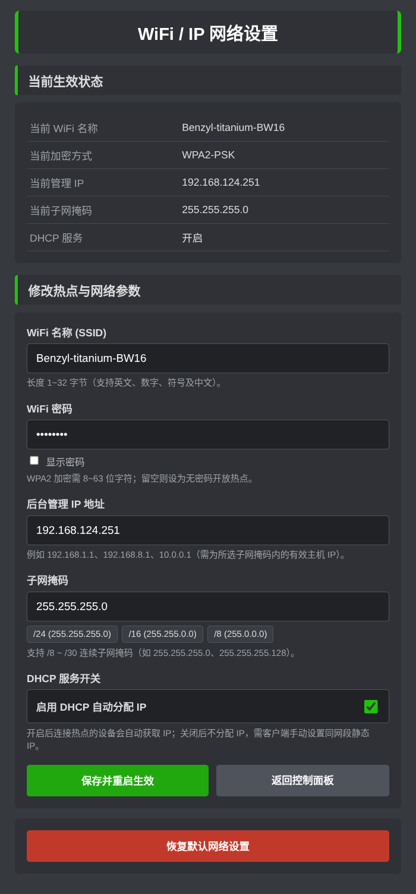
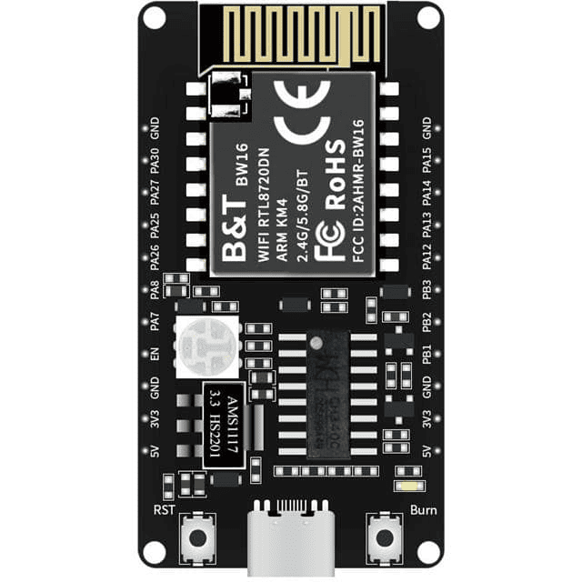
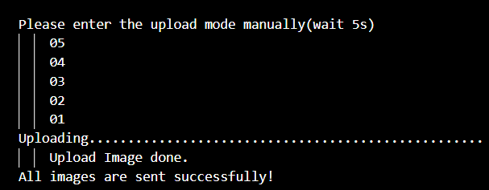
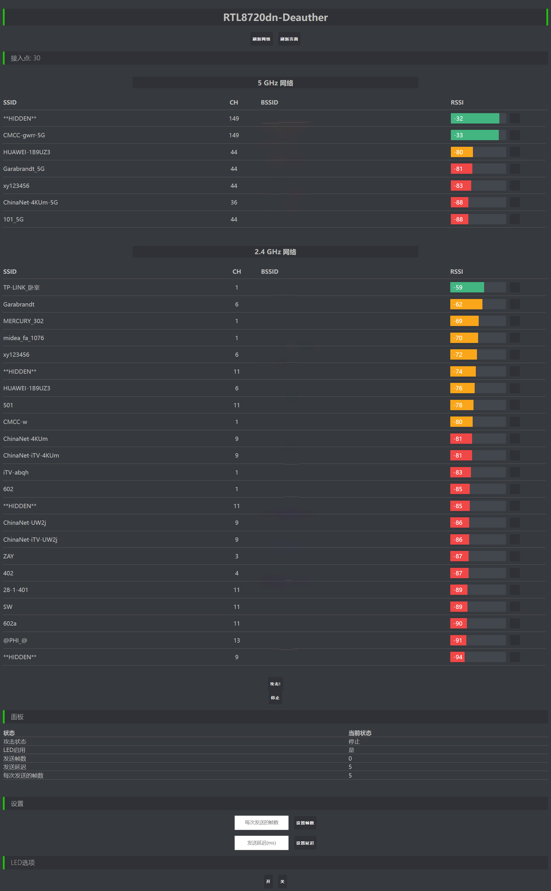
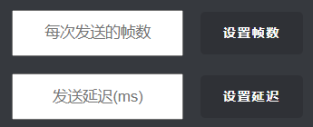

## 简介

本教程使用RTL8720DN模块制作WiFi杀手，能够对2.4GHz和5GHz的Wi-Fi进行Deauth攻击，强行切断用户与Wi-Fi网络的连接。  
经实验，能够令方圆5米左右的设备掉线/严重丢包，但是对WPA3无效。

最低配置只需要一个RTL8720DN模块，成本约30元，无需短接，顺便买一个天线，能搜索的范围更大，我会尽量写的容易理解。

> [!CAUTION]
> 本教程仅供学习参考，请勿用于非法用途，否则可能构成犯罪。  
> 使用者需自行承担全部操作风险及法律后果。

## 前期准备

### 环境搭建

- 从[Arduino](https://www.arduino.cc/en/software/#ide)官网下载Arduino IDE并安装。
- 点击左上角File，选择Preferences，在弹出的窗口中，你可以改一下语言。  
接下来的步骤都默认你的软件已经切换到了中文。
- 还是刚刚的首选项页面，找到`其他开发板管理地址`，并添加下面的链接，点击确定，会经过一小会的下载。

```
https://github.com/ambiot/ambd_arduino/raw/master/Arduino_package/package_realtek.com_amebad_index.json
```

- 在`工具>开发板>开发板管理器`中搜索`rtl`，安装`32-bits ARM Cortex-M33 @200MHz`这个，版本选择最新的3.1.7即可。

### 连接模块

- 下载驱动程序并安装：[CH341SER.EXE](https://data.vanadiry.com/app/CH341SER.EXE)，备用。
- 把你的板子连接到电脑，打开设备管理器查看串口设备，应该会看到`COM+数字`的设备，这就是你的板子。
- 在Arduino IDE中，点击`工具>开发板`，选择 `Ai-Thinker BW16(RTL8720DN)`。
- 在Arduino IDE左上部分，点击你板子的名字，选择对应的串口。
- 右下角显示`设备名在COM xx上`即表示连接成功。

### 修改程序

```
git clone https://github.com/Benzyl-titanium/RTL8720dn-Deauther.git
```

- 用Arduino IDE打开RTL8720dn-Deauther/RTL8720dn-Deauther/RTL8720dn-Deauther.ino
- 这个模块会建立一个WiFi供你连接到后台，你可以自定你的WiFi名称，密码，ip和掩码以及是否开启dhcp，这些也可以在Wbe上修改。

```ino
37 const char *DEFAULT_SSID = "BW16"; // 默认 WiFi 名称
38 const char *DEFAULT_PASS = "1234567890";             // 默认 WiFi 密码 (8~63位，留空为开放网络)
39 const uint8_t DEFAULT_IP[4] = {192, 168, 1, 1};      // 默认后台管理 IP
40 const uint8_t DEFAULT_MASK[4] = {255, 255, 255, 0};  // 默认子网掩码
41 const bool DEFAULT_DHCP = true;                      // 默认开启 DHCP 服务
```



### 上传程序

你的板子应该还在电脑上连着，现在拿着它。



点击Arduino IDE左上角的上传按钮（向右箭头），等待的五秒内，按住`BURN`按钮不松手，然后点一下`RST`按钮，接着松开`BURN`按钮，板子会进入下载模式。  
USB-C接口向下，一般来说`BURN`按钮是右边那个，然后等待编译和上传完成即可。



这样表示上传成功

## 使用

点击`RST`按钮或者断开板子重新上电，重置一下板子，然后用你的其他设备，连接板子的WiFi。
在浏览器地址栏输入`192.168.1.1`进入后台。



BSSID码掉了。

你会看到很多WiFi的名字，选择你想要攻击的那个（也可以多选）。  
下划，直接点击`攻击!`，这里默认帧数是5，延迟也是5，也可以自定义帧数和延迟，找到`每次发送的帧数`，这里决定你一次批量发多少“deauth”帧。（你可以根据后台里的对照表选择其他的，数值越大，一次性干扰越猛烈，但也更容易被AP检测出来）。  
`发送延迟(ms)`表示攻击间隔（太频繁也容易被检测）。



此时，你板子的LED应该会蓝灯闪烁，代表已经开始攻击。  
如果你用Edge浏览器，可能会跳转到`192.168.1.1/attack`的空页面，刷新页面重新提交即可。

> [!tip]
> 开始攻击后，RTL8720DN的wifi也会无法连接。

## 疑问

Deauth攻击是发送伪造的解除认证帧到客户端，让客户端认为接入点要求断开连接。
简单来说，**主要是攻击客户端，而不是接入点**。

部分家用路由器，日志记录不详细，一般来说查不到。
企业级设备有更完备的日志记录和入侵检测功能，可能会检测到客户端频繁的解除认证，从而判定异常。

最后提醒，**未经授权的Deauth攻击是违法行为**。

## 备注

本教程转自[都学得会的 BW16 (RTL8720DN) WiFi 杀手制作](https://magic.vanadiry.com/blog/tech/013/)  
作者：Vanadiry